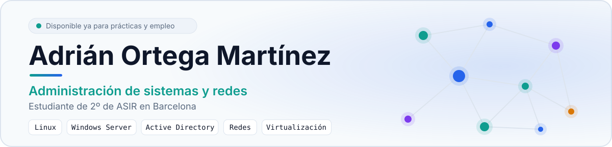

<picture>
  <source media="(prefers-color-scheme: dark)" srcset="hero-dark.svg">
  <source media="(prefers-color-scheme: light)" srcset="hero-light.svg">
  
</picture>

  

  <a href="https://linkedin.com/in/adrian-ortega-martinez"><b>LinkedIn</b></a>
  &nbsp;&nbsp;·&nbsp;&nbsp;
  <a href="mailto:adrianoft07@gmail.com"><b>adrianoft07@gmail.com</b></a>
  &nbsp;&nbsp;·&nbsp;&nbsp;
  <a href="https://github.com/Rakroft"><b>GitHub (@Rakroft)</b></a>
  &nbsp;&nbsp;·&nbsp;&nbsp;

> 🌐 **[Ver mi Portfolio Web completo →](https://rakroft.github.io/Rakroft/)**  
> Diseño animado · Proyectos · Skills · Contacto

---

## Sobre mí

¡Hola! Soy **Adrián Ortega Martínez**, estudiante de 2º curso de **ASIR** (Administración de Sistemas Informáticos en Red) en **DigitechFP, Barcelona**.

Me apasiona entender cómo funciona la tecnología por dentro: desde el montaje y configuración de infraestructura física y virtual hasta el despliegue de servicios y la resolución metódica de incidencias.

Trabajo con entornos **Linux** y **Windows Server** (Active Directory, servicios de red y directivas), y utilizo **Python** y **Bash** para automatizar tareas rutinarias y desarrollar scripts de apoyo. Me considero una persona proactiva, con alta capacidad de aprendizaje autodidacta y un fuerte compromiso con las buenas prácticas y la documentación técnica.

> [!NOTE]
> **Objetivo:** En búsqueda activa de **prácticas formativas (FCT / DUAL) o primer empleo junior** en administración de sistemas, gestión de redes o soporte técnico IT.  
> **Disponibilidad:** Inmediata · Presencial en Barcelona, híbrido o remoto.

---

## Tecnologías y Competencias

Organizadas según las áreas técnicas trabajadas en mi formación y laboratorios:

- **Sistemas Operativos:**
  - **Linux:** Instalación, administración y securización en Debian y Ubuntu Server (entornos CLI).
  - **Windows Server:** Despliegue de controladores de dominio (Active Directory DS), gestión de usuarios/grupos y directivas de grupo (GPO).
  - **Windows Desktop:** Configuración, soporte y resolución de incidencias en Windows 10/11.

- **Redes:**
  - **Fundamentos y Protocolos:** Modelo OSI, pila TCP/IP, direccionamiento IPv4 y cálculo de subredes (VLSM/CIDR).
  - **Conmutación y Enrutamiento:** Segmentación de tráfico mediante VLANs, configuración de enlaces troncales y enrutamiento básico.
  - **Servicios de Red:** Despliegue y administración de servidores DHCP y DNS.

- **Virtualización:**
  - **Hipervisores:** Creación y gestión de máquinas virtuales con Proxmox VE, VMware Workstation y VirtualBox.
  - **Laboratorios Aislados:** Configuración de conmutadores virtuales y redes internas para pruebas seguras de topologías cliente-servidor.
  - **Gestión:** Uso de instantáneas (*snapshots*) y plantillas para recuperación rápida ante fallos.

- **Scripting:**
  - **Bash:** Automatización de tareas administrativas, copias de seguridad y gestión de procesos en Linux.
  - **Python:** Creación de scripts, lógica algorítmica, validación de datos y tratamiento de excepciones.
  - **Bases de Datos:** Consultas relacionales y gestión básica con MySQL.

- **Desarrollo Web y Herramientas:**
  - **Web:** Maquetación estructurada con HTML5 y estilos con CSS3.
  - **Control de Versiones:** Git y GitHub para control de versiones y documentación de proyectos.

---

## Laboratorios y Homelab

Entorno práctico donde aplico, pruebo y documento configuraciones de sistemas y redes:

- **Windows Server y Active Directory:**
  - Despliegue de bosque y dominio en Windows Server.
  - Creación de Unidades Organizativas (OUs), altas/bajas de usuarios y asignación de permisos según el principio de mínimo privilegio.
  - Implementación de directivas de grupo (GPO) para estandarización de equipos cliente y auditoría de seguridad.
  - Configuración de DNS dinámico y servidor DHCP con ámbitos y reservas por dirección MAC.

- **Servidores Linux:**
  - Puesta en marcha de instancias Debian y Ubuntu Server sin entorno gráfico.
  - Configuración de acceso remoto seguro mediante SSH (autenticación obligatoria por par de claves, desactivación de login directo de root).
  - Gestión de permisos POSIX (UGO/RWX), propietarios y automatización de tareas con `cron`.

- **Redes y Conectividad:**
  - Cálculo y asignación de esquemas de direccionamiento IP para redes locales simuladas.
  - Segmentación departamental mediante VLANs para aislar tráfico y mejorar la seguridad.
  - Diagnóstico y resolución de incidencias de conectividad con herramientas estándar (`ping`, `traceroute`, `ss`, `netstat`, `ip`, `tcpdump`).

- **Virtualización:**
  - Implementación de escenarios multi-máquina en Proxmox y VirtualBox simulando entornos cliente-servidor.
  - Creación de redes virtuales internas (*Host-Only* / red interna) para aislamiento respecto a la red física.
  - Gestión de instantáneas (*snapshots*) para pruebas seguras y puntos de restauración.

---

## Proyectos

Scripts y prácticas de desarrollo desarrollados en Python:

- **[Calculadora Modular en Python](https://github.com/Rakroft/proyectos-python/tree/main/calculadora)**  
  Aplicación interactiva por consola con menú de 7 operaciones matemáticas. Cuenta con validación estricta de entradas y gestión de excepciones (`ZeroDivisionError`, `ValueError`).  
  *Stack:* `Python`

- **[Cifrado y Descifrado César](https://github.com/Rakroft/proyectos-python/tree/main/cifrado-cesar)**  
  Implementación del algoritmo criptográfico por sustitución con desplazamiento modular personalizable (1-25) para codificar y descodificar texto.  
  *Stack:* `Python`

- **[Juegos de Lógica y Algoritmos en Consola](https://github.com/Rakroft/proyectos-python/tree/main/juegos-logicos)**  
  Ejercicios prácticos de algoritmos, control de flujo y bucles, incluyendo juego de adivinanza numérica (rango 1 a 1000 con límite de intentos configurables y pistas dinámicas).  
  *Stack:* `Python`

> Repositorio principal de prácticas: [`Rakroft/proyectos-python`](https://github.com/Rakroft/proyectos-python)

---

## Formación Académica

- **CFGS Administración de Sistemas Informáticos en Red (ASIR)**  
  **DigitechFP** · Barcelona · 2º curso (actualmente cursando).

---

## Disponibilidad

- **Modalidad:** Presencial (área de Barcelona), híbrido o remoto.
- **Objetivo:** Prácticas formativas (FCT / FP Dual) o primer empleo junior.
- **Incorporación:** Inmediata.

---

## Contacto

Si estás buscando un estudiante de ASIR proactivo para incorporar a tu equipo técnico, puedes contactarme a través de:

- **Portfolio:** [rakroft.github.io/Rakroft](https://rakroft.github.io/Rakroft/)
- **LinkedIn:** [adrian-ortega-martinez](https://linkedin.com/in/adrian-ortega-martinez)
- **Correo electrónico:** [adrianoft07@gmail.com](mailto:adrianoft07@gmail.com)
- **GitHub:** [@Rakroft](https://github.com/Rakroft)

